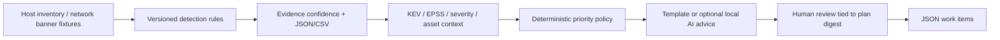

# Exposure Management Engineering Portfolio

Two AI-assisted portfolio projects for vulnerability content engineering and human-reviewed triage. Python 3.11+, standard library only. Built November 2026. These are lab implementations, not commercial product experience. No CrowdStrike integration or endorsement is implied.

| Project | Engineering evidence |
| --- | --- |
| [Detection Content Lab](detection-content-lab/) | Versioned CVE rules, host/network evidence confidence, boundary regression corpus, efficacy report |
| [AI-Assisted Vulnerability Triage](ai-vulnerability-triage/) | Multi-stage workflow, transparent risk policy, optional Ollama, evidence-bound approval and export |

## Reproduce from repository root

```sh
cd exposure-management-portfolio
python -m unittest discover -s tests -v
python detection-content-lab/detect.py
python ai-vulnerability-triage/triage.py plan --as-of 2026-11-26 --out ai-vulnerability-triage/example-plan.json
```

The committed intelligence, asset inventory and context are synthetic. The date is pinned to reproduce the demonstration; use a real assessment date with verified fresh intelligence for another assessment. No credentials, paid services, scanners, exploits, or network requests are needed in default mode. Optional AI sends findings only to a fixed loopback Ollama endpoint when `--model` is explicitly supplied. Live-model quality has not been evaluated; adapter behavior is tested with a mock. AI-generated code and documentation should be studied and explained before presenting the projects in interviews.

## Architecture



See [design and roadmap](DESIGN.md) for limitations, acceptance criteria and interview discussion points. Reports are reproducible fixture results, not production performance claims.
